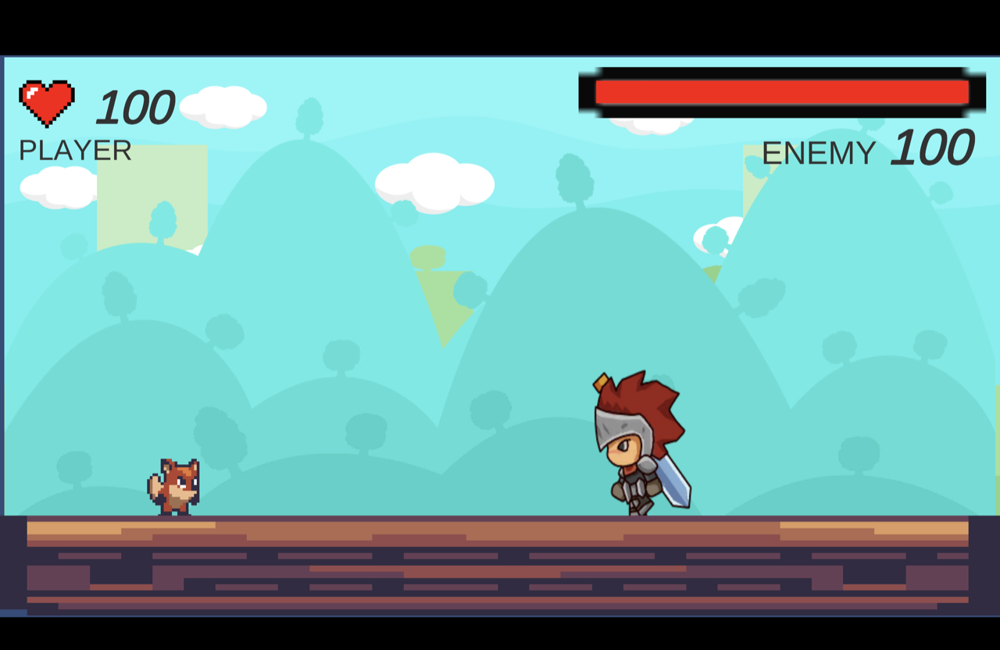

# bringing gun to a sword fight

This is where it all began, my programming journey. Learning to make games from Brackeys and watching the GOAT Dani build games.

So this is a game that's close to my heart, since it's the first one I ever built fully, in class 10th. The gameplay and humor in this might be broken, but the fun is not. So I hope you enjoy your time here playing this!

### ▶ [Play (and lose) yourself](https://kraditya23.github.io/bringing-gun-to-a-sword-fight/)

## Controls

| Action | Key |
|---|---|
| Move | A / D or ← / → |
| Jump | Space |
| Shoot | J or left click |

Desktop browsers only, it needs a keyboard.

## Then and now

Built in Unity 2020.3 in 2021, remastered in Unity 6 in 2026 so it runs in the browser. The untouched 2021 version is tagged [`original-2021`](https://github.com/kraditya23/bringing-gun-to-a-sword-fight/tree/original-2021).

## Credits

- Tutorials: [Brackeys](https://www.youtube.com/@Brackeys)
- Art: BayatGames (Free Platform Game Assets), Knight Files, Sunnyland
- Music: Evan King (Weekly Loops), "Adhi Adhi Raat" by Bilal Saeed